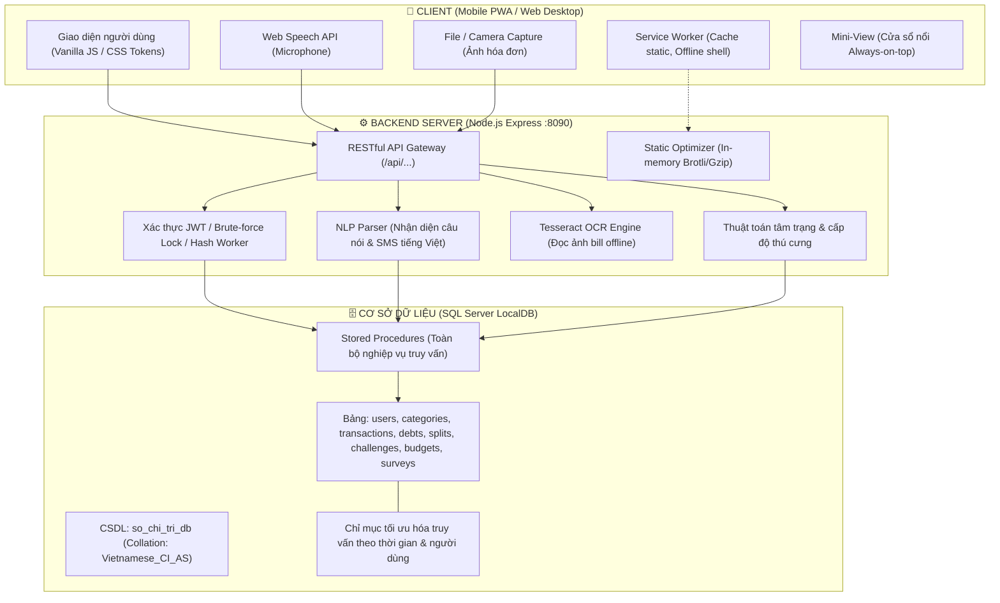

# 💰 SỔ CHI TIÊU (Thu Chi) - HỆ THỐNG QUẢN LÝ TÀI CHÍNH CÁ NHÂN CHO SINH VIÊN

[](https://nodejs.org)
[](https://expressjs.com)
[](https://www.microsoft.com/sql-server)
[](https://web.dev/progressive-web-apps/)
[](https://tesseract.projectnaptha.com/)
[](https://opensource.org/licenses/MIT)

> **Sổ Chi Tiêu** (tên hiển thị ngắn gọn: **Thu Chi**) là ứng dụng web định hướng **Mobile-First (Progressive Web App - PWA)** giúp sinh viên và người trẻ hình thành thói quen quản lý tài chính khoa học, nhẹ nhàng và tự nhiên. Ứng dụng tích hợp công nghệ nhận diện giọng nói tiếng Việt, đọc hóa đơn/chuyển khoản bằng OCR không cần mạng, bóc tách tin nhắn biến động số dư ngân hàng, cùng cơ chế gamification thú cưng tài chính và 25 thử thách tiết kiệm thực tế.

---

## 📑 MỤC LỤC ĐIỀU HƯỚNG NHANH

1. [Kiến Trúc Hệ Thống & Sơ Đồ Kỹ Thuật](#1-kiến-trúc-hệ-thống--sơ-đồ-kỹ-thuật)
2. [Cấu Trúc Thư Mục Dự Án (Project Directory Tree)](#2-cấu-trúc-thư-mục-dự-án-project-directory-tree)
3. [Yêu Cầu Môi Trường & Cài Đặt Ban Đầu](#3-yêu-cầu-môi-trường--cài-đặt-ban-đầu)
4. [Hướng Dẫn Khởi Chạy Ứng Dụng (1-Click Run)](#4-hướng-dẫn-khởi-chạy-ứng-dụng-1-click-run)
5. [Chế Độ Dùng Thử Trải Nghiệm (Không Cần Đăng Ký)](#5-chế-độ-dùng-thử-trải-nghiệm-không-cần-đăng-ký)
6. [Cẩm Nang Sử Dụng Chi Tiết Từng Phân Hệ](#6-cẩm-nang-sử-dụng-chi-tiết-từng-phân-hệ)
   - [Ghi khoản đa phương thức (Nói, Chụp ảnh OCR, SMS, 1 chạm)](#ghi-khoản-đa-phương-thức)
   - [Trang Hôm Nay, Thú Cưng Ví Tiền & Mini-View Ghim Nổi](#trang-hôm-nay-thú-cưng-ví-tiền--mini-view-ghim-nổi)
   - [Lịch Sử Giao Dịch & Heatmap Nhiệt Độ Chi Tiêu](#lịch-sử-giao-dịch--heatmap-nhiệt-độ-chi-tiêu)
   - [Thử Thách Tài Chính & Hệ Thống 25 Huy Hiệu Thói Quen](#thử-thách-tài-chính--hệ-thống-25-huy-hiệu-thói-quen)
   - [Sổ Nợ, Chia Tiền Nhóm & Mẫu Tin Đòi Nợ Khéo Léo](#sổ-nợ-chia-tiền-nhóm--mẫu-tin-đòi-nợ-khéo-léo)
   - [Đối Soát Ví Tiền Thực Tế ("Tiền Bốc Hơi")](#đối-soát-ví-tiền-thực-tế-tiền-bốc-hơi)
   - [Cài Đặt, Tùy Biến Giao Diện, Đa Ngôn Ngữ (vi/en) & Khảo Sát](#cài-đặt-tùy-biến-giao-diện-đa-ngôn-ngữ-vien--khảo-sát)
7. [Mở Ứng Dụng Trên Điện Thoại Thật (Cùng Wi-Fi)](#7-mở-ứng-dụng-trên-điện-thoại-thật-cùng-wi-fi)
8. [Hệ Thống Kiểm Thử Tự Động 3 Cấp Độ](#8-hệ-thống-kiểm-thử-tự-động-3-cấp-độ)
9. [Tối Ưu Hiệu Năng, Chịu Tải Cao & Chuẩn Hóa SEO](#9-tối-ưu-hiệu-năng-chịu-tải-cao--chuẩn-hóa-seo)
10. [Bảng Tra Cứu & Xử Lý Sự Cố Thường Gặp (Troubleshooting)](#10-bảng-tra-cứu--xử-lý-sự-cố-thường-gặp-troubleshooting)

---

## 1. KIẾN TRÚC HỆ THỐNG & SƠ ĐỒ KỸ THUẬT

Hệ thống được thiết kế theo kiến trúc **Monorepo tinh gọn**, loại bỏ các thành phần cồng kềnh, tối ưu hóa độ trễ phản hồi dưới 50ms và hỗ trợ hoàn toàn ngoại tuyến cho các tác vụ then chốt:



---

## 2. CẤU TRÚC THƯ MỤC DỰ ÁN (PROJECT DIRECTORY TREE)

Toàn bộ mã nguồn, kịch bản khởi chạy, cơ sở dữ liệu và tài liệu kiểm thử được tổ chức chặt chẽ theo cấu trúc phân tầng:

```text
Quan_Ly_Chi_Tieu/
├── chay_thu_chi.bat                  # 🚀 Script 1-click khởi chạy toàn bộ hệ thống trên Windows
├── kiem_thu_thu_chi.bat              # 🧪 Script chạy toàn bộ 3 cấp độ kiểm thử (Unit, DB, API)
├── HUONG_DAN_THU_CHI.md              # 📖 Tài liệu kỹ thuật và hướng dẫn sử dụng chính thức
├── .gitignore                        # Cấu hình loại bỏ file rác, node_modules, cache OCR
│
├── backend/                          # ⚙️ MÃ NGUỒN MÁY CHỦ & REST API (Node.js / Express)
│   ├── package.json                  # Khai báo dependency, scripts kiểm thử và chạy tải
│   ├── package-lock.json             # Khóa phiên bản thư viện đảm bảo tính đồng nhất
│   ├── src/
│   │   ├── server.js                 # Điểm khởi động máy chủ API và static server /app
│   │   ├── cluster.js                # Chế độ chạy đa tiến trình (multi-worker cluster) chịu tải cao
│   │   ├── config/
│   │   │   └── db.js                 # Kết nối SQL Server qua ODBC msnodesqlv8 & Connection Pool
│   │   ├── routes/                   # Các route điều hướng REST API (/api/...)
│   │   │   ├── auth.routes.js        # Đăng ký, đăng nhập, khóa sau 5 lần sai, mã khôi phục, đổi mật khẩu
│   │   │   ├── transaction.routes.js # Thêm, sửa, xóa, tìm kiếm, lọc tháng, batch lưu nhiều khoản
│   │   │   ├── dashboard.routes.js   # Số liệu hôm nay, chuỗi ngày, widget Mini-View, heatmap lịch
│   │   │   ├── scan.routes.js        # API bóc tách giọng nói, dán SMS và OCR ảnh hóa đơn
│   │   │   ├── debt.routes.js        # Ghi nợ 2 chiều, chia hóa đơn nhóm (group bill split)
│   │   │   ├── wallet.routes.js      # Kiểm kê đối soát số dư ví thực tế ("Tiền bốc hơi")
│   │   │   ├── budget.routes.js      # Thiết lập và theo dõi hạn mức chi tiêu tháng
│   │   │   ├── challenge.routes.js   # Quản lý 5 thử thách đồng thời và 25 huy hiệu
│   │   │   ├── category.routes.js    # Danh mục thu/chi mặc định, thêm mới, ẩn/hiện, sắp xếp
│   │   │   ├── survey.routes.js      # Khảo sát trải nghiệm sau 1 ngày & tổng hợp ý kiến
│   │   │   └── health.routes.js      # Endpoint giám sát trạng thái máy chủ và kết nối CSDL
│   │   ├── services/                 # Xử lý nghiệp vụ logic (Business Services)
│   │   │   ├── textParse.service.js  # Bóc tách tiếng Việt tự nhiên (giọng nói, SMS, hóa đơn)
│   │   │   ├── ocr.service.js        # Nhận diện chữ quang học qua Tesseract.js ngoại tuyến
│   │   │   ├── pet.service.js        # Thuật toán tính toán tâm trạng & cấp độ thú cưng ví tiền
│   │   │   ├── auth.service.js       # Quản lý khóa tài khoản 5 lần sai, mã khôi phục, phiên đăng nhập
│   │   │   ├── demo.service.js       # Cấp và dọn dẹp tự động tài khoản dùng thử tạm thời (24h)
│   │   │   ├── hash.service.js       # Băm mật khẩu bcrypt trên Worker Threads không chặn event loop
│   │   │   ├── budget.service.js     # Tính toán tiến độ ngân sách và hạn mức chi tiêu mỗi ngày
│   │   │   └── challenge.service.js  # Kiểm tra điều kiện hoàn thành thử thách & mở khóa huy hiệu
│   │   ├── middlewares/              # Middleware bảo mật, xác thực JWT, static file, xử lý lỗi
│   │   │   ├── auth.middleware.js    # Xác thực Bearer JWT token và đính kèm thông tin user
│   │   │   ├── rateLimit.middleware.js# Giới hạn tần suất gọi API chống tấn công DoS
│   │   │   ├── static.middleware.js  # Nén trước Brotli/Gzip, tạo ETag và phục vụ giao diện tĩnh
│   │   │   └── error.middleware.js   # Bắt lỗi toàn cục, trả về mã lỗi chuẩn hóa theo ngôn ngữ
│   │   ├── lib/                      # Các thư viện bổ trợ dùng chung
│   │   │   ├── http.js               # Định nghĩa lớp HttpError và wrapper asyncRoute
│   │   │   ├── validate.js           # Kiểm tra kiểu dữ liệu, định dạng ngày tháng, số tiền
│   │   │   └── i18n.js               # Middleware nhận diện ngôn ngữ qua header X-Lang
│   │   └── lang/                     # Bản địa hóa thông điệp hệ thống
│   │       └── en.js                 # Từ điển dịch thông báo lỗi và danh mục sang tiếng Anh
│   └── tests/                        # 🧪 KỊCH BẢN KIỂM THỬ BACKEND
│       ├── textParse.test.js         # Kiểm thử bóc tách giọng nói, SMS ngân hàng, hóa đơn
│       ├── ocr.test.js               # Kiểm thử đọc số tiền trên ảnh hóa đơn chụp thực tế
│       ├── pet.test.js               # Kiểm thử các trạng thái cảm xúc của thú cưng ví tiền
│       ├── api/
│       │   └── kiem_thu_api.mjs      # Kiểm thử tích hợp End-to-End toàn bộ API trên server thật
│       ├── tai/
│       │   └── kiem_thu_tai.mjs      # Kịch bản mô phỏng 100 người dùng đồng thời đo RPS & độ trễ
│       └── fixtures/                 # Dữ liệu ảnh hóa đơn, chuyển khoản mẫu phục vụ kiểm thử
│
├── frontend/                         # 🎨 GIAO DIỆN NGƯỜI DÙNG (PWA & Desktop)
│   ├── app/                          # Giao diện chính thức: Mobile-First Progressive Web App
│   │   ├── index.html                # Trang ứng dụng chính (khung mobile app, tối ưu cảm ứng)
│   │   ├── mobile.html               # Trang mô phỏng đa thiết bị (iPhone SE, iPhone 14, Android)
│   │   ├── sw.js                     # Service Worker lưu cache tài nguyên, hỗ trợ offline shell
│   │   ├── manifest.json             # Khai báo cấu hình cài đặt PWA lên màn hình chính
│   │   ├── css/
│   │   │   └── app.css               # Hệ thống design tokens, 4 chủ đề màu sắc, dark/light theme
│   │   ├── js/
│   │   │   ├── app.js                # Bộ điều hướng màn hình (Hash Router), quản lý vòng đời app
│   │   │   ├── api.js                # API Client gọi backend, quản lý token, tự động bắt lỗi
│   │   │   ├── ui.js                 # Thư viện component UI (Modal, Bottom Sheet, Toast, DOM helper)
│   │   │   ├── pet.js                # Trình diễn đồ họa và cử động của thú cưng ví tiền
│   │   │   ├── coach.js              # Lời khuyên tài chính thông minh theo thói quen chi tiêu
│   │   │   ├── prefs.js              # Lưu trữ cài đặt giao diện cục bộ (Theme, font, rung haptic)
│   │   │   ├── i18n.js               # Quản lý chuyển đổi ngôn ngữ giao diện (vi / en)
│   │   │   ├── icons.js              # Bộ icon Lucide siêu nhẹ (chỉ đóng gói các icon app sử dụng)
│   │   │   ├── screens/              # Các màn hình chính của ứng dụng
│   │   │   │   ├── auth.js           # Chào mừng, Đăng nhập, Đăng ký, Khôi phục mật khẩu
│   │   │   │   ├── home.js           # Màn hình Hôm nay: Thú cưng, số dư, gợi ý 1 chạm, chuỗi ngày
│   │   │   │   ├── history.js        # Lịch sử giao dịch: Heatmap nhiệt độ chi tiêu, bộ lọc tháng
│   │   │   │   ├── debts.js          # Sổ nợ cá nhân, chia tiền nhóm và soạn tin đòi nợ khéo
│   │   │   │   ├── wallet.js         # Màn hình kiểm kê thực tế ("Tiền bốc hơi")
│   │   │   │   ├── me.js             # Trang cá nhân: Thiết lập ngân sách, phím tắt công cụ
│   │   │   │   ├── challenges.js     # Quản lý thử thách đang chạy và danh mục 25 huy hiệu
│   │   │   │   ├── categories.js     # Quản lý danh mục: Thêm, sửa, ẩn/hiện, kéo thả thứ tự
│   │   │   │   └── settings.js       # Cài đặt hiển thị, chủ đề, mật khẩu, phiên thiết bị, khảo sát
│   │   │   ├── flows/                # Các luồng thao tác tương tác đặc thù
│   │   │   │   ├── add.js            # Bottom sheet ghi khoản: Giọng nói, Ảnh OCR, SMS, Nhập tay
│   │   │   │   ├── mini.js           # Widget Mini-View ghim cửa sổ nổi luôn trên cùng
│   │   │   │   └── survey.js         # Hộp thoại khảo sát cảm nhận sau 1 ngày dùng app
│   │   │   ├── lang/
│   │   │   │   └── en.js             # Toàn bộ chuỗi ngôn ngữ tiếng Anh cho giao diện
│   │   │   └── tools/                # Công cụ sinh icon PWA tự động
│   │   └── icon-192.png, icon-512.png# Bộ biểu tượng ứng dụng PWA
│   ├── load-test.html                # Bảng điều khiển kiểm thử tải trực quan trên nền web
│   ├── index.html                    # Giao diện web desktop dự phòng
│   ├── css/style.css                 # CSS phong cách Fintech cho giao diện desktop
│   └── js/                           # Script xử lý giao diện desktop
│
├── database/                         # 🗄️ KỊCH BẢN CƠ SỞ DỮ LIỆU MICROSOFT SQL SERVER
│   ├── setup_database.bat            # Script khởi tạo CSDL gốc quan_ly_chi_tieu_db
│   ├── create_database.sql           # Tạo CSDL SQL Server với collation Vietnamese_CI_AS
│   ├── create_tables.sql             # Tạo bảng users, categories, transactions và các ràng buộc
│   ├── seed_categories.sql           # Nạp 13 danh mục thu/chi mặc định chuẩn ban đầu
│   ├── procedures.sql                # Các Stored Procedure truy vấn và xử lý dữ liệu cơ bản
│   ├── test_database.sql             # Kiểm tra tính đúng đắn của các ràng buộc CSDL gốc
│   ├── .gitattributes                # Thiết lập mã hóa dòng CRLF cho file .bat
│   └── mo_rong/                      # Bộ kịch bản mở rộng toàn diện (CSDL so_chi_tri_db)
│       ├── setup_mo_rong.bat         # Khởi tạo CSDL so_chi_tri_db hoàn chỉnh cho ứng dụng
│       ├── mo_rong_bang.sql          # Thêm bảng nợ, chia tiền, ngân sách, thử thách, khảo sát
│       ├── mo_rong_thu_tuc.sql       # Thủ tục lưu trữ mở rộng cho tính năng nâng cao
│       └── kiem_thu_mo_rong.sql      # Kịch bản kiểm thử toàn bộ ràng buộc và logic trong CSDL
│
├── docs/                             # 📚 HỒ SƠ TÀI LIỆU KỸ THUẬT & ĐẶC TẢ HỆ THỐNG
│   └── database/
│       ├── README.md                 # Đặc tả chi tiết lược đồ CSDL, sơ đồ quan hệ ERD
│       └── KET_QUA_KIEM_TRA.md       # Biên bản nghiệm thu kiểm thử ràng buộc CSDL
│
└── bao cao hinh thanh y tuong/       # 📑 TÀI LIỆU KHẢO SÁT & ĐỀ TÀI
    ├── Bao_cao_hinh_thanh_y_tuong... # Báo cáo hình thành ý tưởng đề tài (Microsoft Word)
    └── KHAO SAT THOI QUEN VA NHU...  # Dữ liệu khảo sát nhu cầu quản lý chi tiêu (Microsoft Excel)
```

---

## 3. YÊU CẦU MÔI TRƯỜNG & CÀI ĐẶT BAN ĐẦU

Trước khi khởi chạy, máy tính của bạn cần có các thành phần nền tảng sau:

| Thành phần | Phiên bản khuyến nghị | Hướng dẫn cài đặt & Kiểm tra |
| :--- | :--- | :--- |
| **Node.js** | Bản LTS (v18.x trở lên) | Tải tại [nodejs.org](https://nodejs.org). Kiểm tra: `node -v` |
| **SQL Server Express LocalDB** | 2019 / 2022 / 2025 | Tích hợp sẵn trong Visual Studio, hoặc chọn thành phần **LocalDB** khi cài đặt [SQL Server Express](https://www.microsoft.com/sql-server/sql-server-downloads) |
| **sqlcmd** | Tiện ích dòng lệnh SQL Server | Đi kèm SQL Server. Kiểm tra: `sqlcmd -?` |
| **ODBC Driver 17 for SQL Server** | Driver ODBC 17 hoặc 18 | Tải từ Microsoft để Node.js kết nối trực tiếp LocalDB qua driver native |

> [!NOTE]
> Bạn **không cần chạy `npm install` thủ công**: File `chay_thu_chi.bat` sẽ tự động phát hiện thư mục `node_modules` và cài đặt đầy đủ thư viện phụ thuộc ở lần chạy đầu tiên.

---

## 4. HƯỚNG DẪN KHỞI CHẠY ỨNG DỤNG (1-CLICK RUN)

### Khởi chạy tiêu chuẩn

Chỉ cần **bấm đúp chuột vào file `chay_thu_chi.bat`** tại thư mục gốc của dự án. Script sẽ tự động thực hiện quy trình 4 bước:

1. **Kiểm tra công cụ:** Đảm bảo Node.js và `sqlcmd` đã sẵn sàng.
2. **Khởi động LocalDB:** Bật instance `MSSQLLocalDB`, tự động tạo CSDL `so_chi_tri_db` nếu chưa có (kèm toàn bộ bảng và stored procedure mở rộng).
3. **Mở máy chủ Node.js:** Chạy server tại cổng **`8090`** trong cửa sổ console riêng mang tên *"ThuChi - May chu"*.
4. **Mở trình duyệt:** Tự động mở địa chỉ `http://localhost:8090/app/` và in ra địa chỉ IP nội bộ để mở bằng điện thoại cùng mạng Wi-Fi.

> [!TIP]
> **Cách tắt máy chủ:** Đơn giản là đóng cửa sổ console mang tên *"ThuChi - May chu"*.

### Các chế độ chạy nâng cao qua Command Prompt

Mở cửa sổ `cmd` tại thư mục gốc dự án và gõ các lệnh sau tùy mục đích:

```bat
:: 1. Mở giao diện mô phỏng khung điện thoại đa thiết bị (iPhone SE, iPhone 14, Android):
chay_thu_chi.bat dienthoai

:: 2. Xóa và tạo lại toàn bộ CSDL từ đầu (Lưu ý: Dữ liệu đã nhập sẽ bị xóa sạch):
chay_thu_chi.bat taolai

:: 3. Chạy toàn bộ hệ thống kiểm thử tự động (Unit test, SQL Server test, API E2E test):
chay_thu_chi.bat kiemthu

:: 4. Chạy chế độ chịu tải đa tiến trình (Cluster mode tận dụng tối đa 8 nhân CPU):
chay_thu_chi.bat chiutai
```

---

## 5. CHẾ ĐỘ DÙNG THỬ TRẢI NGHIỆM (KHÔNG CẦN ĐĂNG KÝ)

Để giảng viên, bạn bè hoặc người dùng mới có thể trải nghiệm ngay mà không tốn thời gian tạo tài khoản:

1. Tại màn hình Chào mừng, bấm nút **"Dùng thử ngay - không cần đăng ký"**.
2. Hệ thống sẽ lập tức khởi tạo một tài khoản thử nghiệm ngẫu nhiên với đầy đủ dữ liệu mẫu (các khoản chi tiêu, lịch sử giao dịch, mục tiêu ngân sách, thử thách đang chạy và thú cưng).
3. Băng thông báo màu tím ở đầu trang sẽ hiển thị thời gian còn lại của phiên dùng thử (mặc định **24 giờ**).
4. Bất kỳ lúc nào trong quá trình trải nghiệm, người dùng chỉ cần bấm nút **"Lưu lại"** trên băng màu tím để đặt tên đăng nhập, mật khẩu cá nhân và chuyển đổi thành tài khoản chính thức mà không bị mất bất kỳ dữ liệu nào.

---

## 6. CẨM NANG SỬ DỤNG CHI TIẾT TỪNG PHÂN HỆ

### Ghi khoản đa phương thức

Bấm nút tròn lớn mang biểu tượng dấu **+** ở giữa thanh điều hướng dưới cùng để mở menu ghi nhận chi tiêu:

- 🎙️ **Nói để ghi (Speech-to-Text):** Bấm biểu tượng micro và nói tự nhiên bằng tiếng Việt (Ví dụ: *"sáng ăn bún bò 45k, chiều đổ xăng 50 nghìn"*). Thuật toán NLP nội bộ sẽ tự động bóc tách thành 2 khoản riêng biệt, suy đoán danh mục và gán thời gian chính xác để bạn duyệt chỉ với 1 click.
- 📸 **Chụp ảnh / Quét hóa đơn (OCR Offline):** Cho phép chọn cùng lúc tối đa 10 ảnh (Hóa đơn mua sắm, biên lai siêu thị, ảnh chụp màn hình chuyển khoản ngân hàng Vietcombank, Techcombank, MB, MoMo...). Công nghệ OCR ngoại tuyến sẽ tự động trích xuất tổng tiền, ngày giờ và gợi ý danh mục tương ứng.
- 📩 **Dán tin nhắn SMS ngân hàng:** Dán nguyên văn tin nhắn biến động số dư. Thuật toán sẽ thông minh nhận diện đúng khoản tiền bị trừ hoặc được cộng, tuyệt đối **không bị nhầm lẫn số dư khả dụng (SD)** thành số tiền giao dịch.
- ⚡ **Ghi một chạm (Quick Shortcuts):** Các khoản chi lặp lại thường nhật như *Gửi xe (5k)*, *Cơm trưa (35k)*... chỉ cần chạm 1 lần là lưu ngay. Trang chủ sẽ tự học thói quen và đẩy các nút gợi ý này lên đầu theo khung giờ tương ứng.
- ✍️ **Nhập tay truyền thống:** Nhập số tiền, chọn danh mục, ghi chú và tùy chỉnh ngày giờ theo ý muốn.

### Trang Hôm Nay, Thú Cưng Ví Tiền & Mini-View Ghim Nổi

- **Hạn mức chi tiêu ngày:** Hiển thị số tiền bạn đã tiêu trong ngày và số tiền tối đa bạn được phép tiêu mỗi ngày còn lại trong tháng dựa theo ngân sách đã đặt.
- 🐾 **Thú cưng tài chính (Pet Mood):** Trực quan hóa tình trạng tài chính của bạn qua cảm xúc của thú cưng:
  - *Vui vẻ, tăng cấp (Level up):* Khi bạn ghi chép đều tay và chi tiêu trong hạn mức.
  - *Nhảy múa (Quẩy):* Khi bạn duy trì chuỗi ghi chép liên tiếp 7 ngày.
  - *Buồn ngủ / Ngủ say:* Khi bạn lười ghi chép hoặc quên mở app.
  - *Lo lắng / Bật khóc:* Khi bạn chi tiêu vượt hạn mức ngày hoặc làm thâm hụt ngân sách tháng.
- 🔥 **Chuỗi ngày ghi chép (Streak):** Theo dõi số ngày liên tiếp bạn có ý thức tài chính. Những ngày không phát sinh chi tiêu vẫn được tính vào chuỗi nếu bạn đánh dấu.
- 🌙 **Lời nhắc buổi tối (Evening Nudge):** Sau 20:00 mỗi tối, nếu bạn chưa ghi khoản nào, app sẽ nhẹ nhàng hỏi *"Hôm nay bạn có tiêu gì không?"*. Chỉ cần chọn *"Hôm nay không tiêu gì"* để bảo toàn chuỗi thói quen.
- 📌 **Mini-View Ghim Nổi (Picture-in-Picture):** Bấm biểu tượng khung nổi cạnh ảnh đại diện. Một cửa sổ widget siêu nhỏ sẽ luôn ghim trên cùng (Always-on-top) màn hình máy tính, hiển thị tổng tiền đã chi hôm nay và có sẵn ô ghi nhanh (Ví dụ: gõ *"cà phê 25k"* rồi ấn Enter).

### Lịch Sử Giao Dịch & Heatmap Nhiệt Độ Chi Tiêu

- **Bản đồ nhiệt chi tiêu (Calendar Heatmap):** Các ngày trong tháng được tô màu theo mức độ chi tiêu (ngày chi càng nhiều màu càng đậm, ngày không tiêu tiền có biểu tượng xanh lá nhẹ nhàng).
- **Bộ lọc và tìm kiếm đa năng:** Tra cứu nhanh theo tháng, lọc riêng thu hoặc chi, tìm kiếm theo tên món đồ đã ghi chú hoặc theo danh mục.
- 💡 **Tổng kết tuần của bạn (Weekly Wrap-up):** Luôn bắt đầu bằng những lời khen tích cực trước (Ví dụ: *"Tuần này bạn có 2 ngày không tiêu tiền và tiết kiệm hơn tuần trước 15%"*), sau đó mới khéo léo đưa ra 1 điểm cần chú ý. Tổng tiền tuần được ẩn sau nút bấm để tránh tạo áp lực tâm lý cho người dùng.

### Thử Thách Tài Chính & Hệ Thống 25 Huy Hiệu Thói Quen

- **Gợi ý cá nhân hóa dựa trên dữ liệu thật:** Hệ thống tự động phân tích 30 ngày gần nhất của bạn. Nếu phát hiện bạn chi nhiều cho *Cà phê, Trà sữa, GrabFood, Shopee, Mua sắm online hay Thuốc lá*, app sẽ tự động đề xuất thử thách tương ứng (Ví dụ: *"Cắt giảm 40% tiền trà sữa trong 14 ngày"*).
- **3 Cấp độ & 3 Khung thời gian linh hoạt:**
  - Cấp độ: **Nhẹ** (-20% chi phí) | **Vừa** (-40%) | **Gắt** (-60%).
  - Thời hạn: **7 ngày** | **14 ngày** | **30 ngày**.
  - Chạy tối đa **5 thử thách cùng lúc** với đồng hồ đếm ngược thời gian thực.
- 🏆 **Bộ sưu tập 25 Huy hiệu thành tựu:** Chia làm 3 hạng Đồng, Bạc, Vàng khích lệ người dùng kiên trì (Ví dụ: *Chiến thần kiềm chế, Đứng dậy sau vấp ngã, Bàn tay vàng giữ lại 1 triệu đồng...*).

### Sổ Nợ, Chia Tiền Nhóm & Mẫu Tin Đòi Nợ Khéo Léo

- **Sổ nợ 2 chiều:** Theo dõi rành mạch *Ai nợ mình* và *Mình nợ ai*. Hỗ trợ gom tổng nợ theo từng người và nút *"Đã trả hết"* để chốt sổ 1 chạm.
- 🍕 **Chia tiền nhóm (Bill Splitter):** Đi ăn uống cùng bạn bè, bạn chỉ cần nhập tổng hóa đơn, tick chọn danh sách người tham gia và chọn ai là người đứng ra thanh toán. App sẽ tự động chia đều, ghi phần của bạn vào chi tiêu cá nhân và tự động tạo khoản nợ cho những người còn lại.
- 💬 **Soạn sẵn tin nhắn nhắc nợ khéo léo:** Tích hợp tính năng sinh tin nhắn đòi nợ theo 3 phong cách:
  - *Nhẹ nhàng:* Tế nhị, giữ hòa khí bạn bè.
  - *Hài hước:* Vui vẻ, bắt trend hóm hỉnh.
  - *Rõ ràng:* Minh bạch con số, chuyển khoản nhanh qua mã QR.

### Đối Soát Ví Tiền Thực Tế ("Tiền Bốc Hơi")

Nhiều khi bạn cảm thấy tiền trong túi cứ tự biến mất mà không rõ lý do. Chức năng **Tiền bốc hơi** (trong mục *Tôi*) giúp bạn:

1. Nhập số tiền mặt thực tế trong ví (có công cụ hỗ trợ đếm nhanh từng mệnh giá tiền) và số dư tài khoản ngân hàng.
2. Ứng dụng so khớp với số tiền lý thuyết theo sổ sách kế toán.
3. Nếu phát hiện chênh lệch thiếu, chỉ cần tick chọn *"Ghi luôn phần chênh lệch"*, hệ thống sẽ tự động hạch toán khoản tiền mất tích này vào mục *"Chi không nhớ"* để số dư trong sổ lập tức khớp chuẩn 100% với thực tế.

### Cài Đặt, Tùy Biến Giao Diện, Đa Ngôn Ngữ (vi/en) & Khảo Sát

Truy cập qua biểu tượng **Bánh răng cài đặt** ở góc trên cùng bên phải:

- **Tùy biến hiển thị:** Chọn chế độ Sáng / Tối / Tự động theo hệ điều hành; 4 bộ màu chủ đạo (*Kẹo ngọt, Biển xanh, Bạc hà, Hoàng hôn*); điều chỉnh cỡ chữ (*Nhỏ, Vừa, Lớn*); bật/tắt phản hồi rung haptic khi chạm.
- **Hỗ trợ 2 ngôn ngữ toàn diện (Tiếng Việt & English):** Chuyển đổi ngôn ngữ tức thì, dịch chuẩn xác cả giao diện, thông báo lỗi máy chủ và danh mục mặc định.
- **Quản trị danh mục:** Cho phép tạo danh mục riêng; ẩn bớt danh mục không dùng (khoản cũ vẫn giữ nguyên, không sợ mất dữ liệu); hỗ trợ sắp xếp thứ tự ưu tiên đẩy danh mục hay dùng lên đầu.
- **Bảo mật nhiều lớp:** Đổi mật khẩu, tạo mã khôi phục dự phòng (Recovery Code), xem danh sách các phiên thiết bị đang đăng nhập và đăng xuất từ xa.
- 📋 **Khảo sát cảm nhận 1 phút:** Sau 24 giờ đăng ký, app sẽ hiện bảng hỏi ngắn để lắng nghe trải nghiệm của bạn nhằm tiếp tục nâng cấp sản phẩm.

---

## 7. MỞ ỨNG DỤNG TRÊN ĐIỆN THOẠI THẬT (CÙNG WI-FI)

Bạn hoàn toàn có thể dùng điện thoại thật (iPhone, Android) để trải nghiệm như một ứng dụng di động thực thụ:

1. Đảm bảo điện thoại và máy tính chạy server đang **kết nối chung một mạng Wi-Fi**.
2. Chạy `chay_thu_chi.bat`, console sẽ in ra dòng:

   ```text
   Điện thoại: http://192.168.x.x:8090/app/
   ```

3. Mở trình duyệt trên điện thoại (Safari trên iOS hoặc Chrome trên Android) và gõ địa chỉ IP ở trên.
4. Chọn tính năng **"Thêm vào màn hình chính" (Add to Home Screen)**. Biểu tượng ứng dụng Sổ Chi sẽ xuất hiện trên màn hình điện thoại, mở lên toàn màn hình không có thanh địa chỉ duyệt web như app native tải từ App Store/Google Play!

> [!NOTE]
> Nếu điện thoại không tải được trang, hãy kiểm tra **Windows Defender Firewall** trên máy tính và cho phép tiến trình Node.js kết nối qua mạng Private.

---

## 8. HỆ THỐNG KIỂM THỬ TỰ ĐỘNG 3 CẤP ĐỘ

Hệ thống được trang bị bộ kiểm thử tự động toàn diện, có thể kích hoạt chỉ với một thao tác:
👉 **Bấm đúp file `kiem_thu_thu_chi.bat`** (hoặc gõ lệnh `chay_thu_chi.bat kiemthu`).

Quy trình kiểm thử diễn ra qua 3 phân tầng nghiêm ngặt:

```text
================================================================================
KỊCH BẢN KIỂM THỬ TOÀN DIỆN (AUTOMATED TEST SUITE)
================================================================================
1. KIỂM THỬ ĐƠN VỊ (UNIT TEST - BACKEND):
   - Nhận diện câu nói tiếng Việt (30k, 50 nghìn, nhiều khoản, hôm qua, giờ giấc).
   - Suy đoán danh mục thông minh theo từ khóa ngữ nghĩa.
   - Bóc tách SMS ngân hàng (Vietcombank, Techcombank, MB, ACB, MoMo...).
   - Nhận diện số tiền trên ảnh hóa đơn chụp bóng mờ, nhãn lệch dòng qua Tesseract OCR.
   - Kiểm tra logic cảm xúc và thăng cấp của thú cưng ví tiền (Pet Logic).
   => Kết quả: 33/33 TEST ĐẠT (100% PASS).

2. KIỂM THỬ RÀNG BUỘC CƠ SỞ DỮ LIỆU (DATABASE INTEGRITY TEST):
   - Chạy kịch bản database\mo_rong\kiem_thu_mo_rong.sql trên SQL Server LocalDB.
   - Kiểm tra toàn vẹn khóa ngoại, ràng buộc CHECK số tiền > 0, mã băm bcrypt.
   - Kiểm tra các Stored Procedure: chia tiền nhóm, đối soát số dư, chuỗi ngày.
   => Kết quả: TOÀN BỘ STORED PROCEDURE & TRIGGER ĐẠT.

3. KIỂM THỬ TÍCH HỢP ĐẦU CUỐI (API END-TO-END VERIFICATION):
   - Tự động bật máy chủ tạm thời tại cổng độc lập 8099.
   - Chạy kịch bản backend\tests\api\kiem_thu_api.mjs kiểm thử toàn bộ REST API:
     * Đăng ký, đăng nhập, khóa tài khoản sau 5 lần nhập sai, mở khóa bằng mã dự phòng.
     * Thêm/sửa/xóa giao dịch, batch insert, lọc tháng, tìm kiếm full-text.
     * Nhận diện giọng nói, bóc tách SMS, nhận diện ảnh hóa đơn.
     * Sổ nợ, chia tiền nhóm, đối soát ví tiền, khảo sát người dùng.
     * Thử thách tài chính, kiểm soát hạn mức, bỏ cuộc, tính toán 25 huy hiệu.
     * Đa ngôn ngữ (X-Lang: en/vi), cô lập dữ liệu người dùng (chống đọc trộm dữ liệu chéo).
   - Tự động tắt máy chủ tạm và dọn dẹp sạch sẽ tài khoản thử nghiệm "kt_api_...".
   => Kết quả: 81/81 CA KIỂM THỬ ĐẠT (100% PASS).
================================================================================
```

---

## 9. TỐI ƯU HIỆU NĂNG, CHỊU TẢI CAO & CHUẨN HÓA SEO

### Tối ưu hóa giao diện cho thiết bị cấu hình yếu

- **Render mượt mà 60-120 FPS:** Hiệu ứng chuyển động sử dụng CSS GPU-accelerated transform, tuyệt đối không gây reflow/repaint bố cục. Thú cưng tự động tạm dừng cử động khi nằm ngoài vùng nhìn thấy (Viewport) để tiết kiệm pin.
- **Chế độ tiết kiệm tài nguyên (Low-spec Mode):** Ứng dụng tự động phát hiện thiết bị có dưới 4 nhân CPU hoặc RAM dưới 4GB để tắt bớt hoạt họa trang trí, ưu tiên tối đa độ phản hồi mượt mà cho các thao tác kế toán.
- **Gói icon siêu nhẹ:** Bộ icon Lucide được biên dịch chọn lọc, chỉ nạp 118 biểu tượng ứng dụng cần (kích thước nén chỉ ~6 KB thay vì nạp toàn bộ thư viện 358 KB).

### Tối ưu hóa máy chủ & Chịu tải cao

- **In-memory Pre-compressed Cache:** Toàn bộ file giao diện được nén sẵn cả 2 định dạng **Brotli** và **Gzip** lưu trực tiếp trên RAM, kết hợp cơ chế kiểm tra `ETag` giúp trình duyệt tái sử dụng cache với mã phản hồi `304 Not Modified`, tiết kiệm 95% băng thông.
- **Worker Threads cho Bcrypt:** Thao tác băm và kiểm tra mật khẩu được chuyển sang thực thi trên Worker Threads riêng biệt, đảm bảo các tác vụ CPU-intensive không gây nghẽn Event Loop của Node.js.
- **Truy vấn gộp (Multi-resultset Query):** Trang chủ lấy toàn bộ 5 nhóm chỉ số tài chính chỉ trong **1 lần đi-về CSDL** (thay vì gọi 5 truy vấn rời rạc).

### Kết quả đo lường kiểm thử tải (Benchmark)

Đo lường bằng công cụ `backend/tests/tai/kiem_thu_tai.mjs` với kịch bản mô phỏng **100 người dùng ảo đồng thời** trên máy tính cá nhân (SQL Server LocalDB):

| Phân hệ kiểm thử | Chế độ 1 tiến trình (Single Core) | Chế độ đa tiến trình (Cluster 4 Cores) |
| :--- | :---: | :---: |
| **Trang chủ tĩnh `/app/`** | ~2.400 req/giây | **~4.300 req/giây** |
| **Tập tin giao diện `app.css` (Brotli)** | ~3.300 req/giây | **~4.100 req/giây** |
| **API Dashboard tổng hợp** | ~270 req/giây | **~350 req/giây** |
| **API Đăng nhập (Bcrypt cost 10)** | ~34 req/giây | **~35 req/giây** |

> [!NOTE]
> Mức thông lượng ~350 yêu cầu API/giây tương đương với khả năng phục vụ đồng thời cho **vài chục nghìn người dùng hoạt động** trong cùng một khung giờ cao điểm trên môi trường thực tế.

---

## 10. BẢNG TRA CỨU & XỬ LÝ SỰ CỐ THƯỜNG GẶP (TROUBLESHOOTING)

| Hiện tượng lỗi | Nguyên nhân khả dĩ | Giải pháp xử lý triệt để |
| :--- | :--- | :--- |
| **"LỖI: chưa cài Node.js"** | Máy tính chưa có Node.js hoặc chưa nhận biến môi trường PATH | Tải và cài đặt Node.js LTS từ [nodejs.org](https://nodejs.org), sau đó đóng cmd và mở lại. |
| **"LỖI: chưa có sqlcmd"** | Chưa cài đặt công cụ dòng lệnh của SQL Server | Cài đặt SQL Server Express (chọn thành phần LocalDB) hoặc cài gói *sqlcmd utility* từ Microsoft. |
| **"Login timeout expired" hoặc "Server is not found"** | SQL Server LocalDB tự rơi vào trạng thái ngủ đông khi lâu không dùng | File `.bat` đã tích hợp cơ chế tự động chờ và đánh thức LocalDB trong 30 giây. Nếu bị kẹt tiến trình cũ, script sẽ tự động khởi động lại `sqlservr.exe`. Nếu vẫn lỗi, hãy khởi động lại máy tính. |
| **"Máy chủ không phản hồi sau 40 giây"** | Thiếu thư viện ODBC driver kết nối SQL Server | Cài đặt **ODBC Driver 17 for SQL Server** (hoặc bản 18) từ trang chủ Microsoft. |
| **Cổng 8090 bị báo đang sử dụng (Port in use)** | Có ứng dụng khác đang chiếm dụng cổng 8090 | Đóng ứng dụng đó, hoặc mở file `chay_thu_chi.bat` và sửa dòng `set "PORT=8090"` thành một cổng trống khác (ví dụ: `8095`). |
| **Tài khoản bị tạm khóa sau 5 lần đăng nhập** | Cơ chế chống tấn công dò mật khẩu tự động kích hoạt | Tài khoản được bảo vệ tạm khóa trong **5 phút**. Hết thời gian trên bạn có thể đăng nhập lại, hoặc sử dụng tính năng *"Quên mật khẩu"* với Mã khôi phục đã cấp. |
| **Quên mật khẩu đăng nhập** | Người dùng không nhớ mật khẩu tài khoản | Tại màn hình Đăng nhập, bấm **"Quên mật khẩu?"** và nhập Mã khôi phục dự phòng đã nhận lúc đăng ký. Hệ thống sẽ cấp mật khẩu mới và một mã dự phòng thay thế. |
| **Sửa đổi code nhưng trình duyệt không cập nhật** | Trình duyệt giữ cache Service Worker cũ | Nhấn tổ hợp phím **Ctrl + Shift + R** (hoặc `Cmd + Shift + R` trên Mac) để xóa cache cưỡng bức và nạp mã nguồn mới nhất. |

---

*Phát triển bởi Nhóm Dự Án Quản Lý Chi Tiêu © 2026. Mọi quyền được bảo lưu.*
