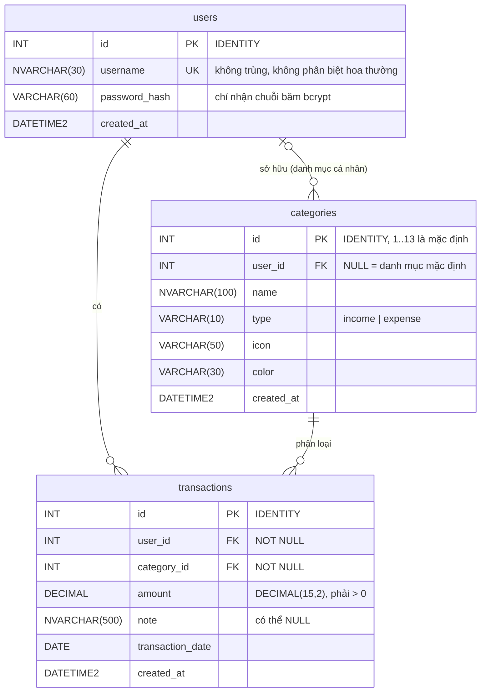

# Cơ sở dữ liệu – Quản Lý Chi Tiêu (SQL Server)

- **Issue:** [S1-DB-01] Thiết kế và tạo cơ sở dữ liệu SQL Server (#11)
- **Người phụ trách:** Trí (Database) – phối hợp: Việt (Backend)
- **Hệ quản trị:** Microsoft SQL Server 2019 trở lên (đã kiểm thử trên SQL Server 2025 LocalDB)
- **Tên CSDL:** `quan_ly_chi_tieu_db` – collation `Vietnamese_CI_AS`

## 1. Sơ đồ quan hệ (ERD)



**Quan hệ:**

| Quan hệ | Kiểu | Khi xóa |
|---|---|---|
| `users` → `transactions` | 1 – nhiều (mỗi giao dịch thuộc đúng 1 người dùng) | Xóa người dùng → xóa luôn giao dịch của họ |
| `users` → `categories` | 0..1 – nhiều (chỉ danh mục cá nhân có chủ) | Xóa người dùng → xóa luôn danh mục cá nhân của họ |
| `categories` → `transactions` | 1 – nhiều (mỗi giao dịch thuộc đúng 1 danh mục) | Không cho xóa danh mục đang có giao dịch |

## 2. Mô tả các bảng

### 2.1. `users` – Người dùng

| Cột | Kiểu | Ràng buộc | Ghi chú |
|---|---|---|---|
| `id` | INT IDENTITY | PK | |
| `username` | NVARCHAR(30) | NOT NULL, UNIQUE, ≥ 3 ký tự | Không phân biệt hoa thường (`Tri` = `tri`) |
| `password_hash` | VARCHAR(60) | NOT NULL, CHECK định dạng bcrypt | **Không lưu mật khẩu gốc.** Chuỗi phải dài 60 ký tự và bắt đầu bằng `$2a$`, `$2b$` hoặc `$2y$` |
| `created_at` | DATETIME2(0) | DEFAULT `SYSDATETIME()` | |

### 2.2. `categories` – Danh mục thu/chi

| Cột | Kiểu | Ràng buộc | Ghi chú |
|---|---|---|---|
| `id` | INT IDENTITY | PK | id 1–13 cố định cho danh mục mặc định |
| `user_id` | INT | FK → `users.id`, NULL được | **NULL = danh mục mặc định**, có giá trị = danh mục cá nhân |
| `name` | NVARCHAR(100) | NOT NULL, không rỗng | |
| `type` | VARCHAR(10) | CHECK `income` / `expense` | |
| `icon` | VARCHAR(50) | DEFAULT `circle-ellipsis` | Tên icon Lucide dùng ở Frontend |
| `color` | VARCHAR(30) | DEFAULT `blue` | |
| `created_at` | DATETIME2(0) | DEFAULT `SYSDATETIME()` | |

`UNIQUE (user_id, type, name)`: một người không có 2 danh mục trùng tên trong cùng loại. Thủ tục `sp_add_category` chặn thêm việc đặt tên danh mục cá nhân trùng với danh mục mặc định.

**Phân biệt danh mục mặc định và danh mục cá nhân:**

- **Mặc định** (`user_id IS NULL`): 13 danh mục, ai cũng thấy và dùng được, nạp bởi `seed_categories.sql`.
- **Cá nhân** (`user_id = id người tạo`): chỉ chủ sở hữu thấy và dùng được. Người khác không thể gắn giao dịch vào danh mục này. Thủ tục chặn với mã 50003, trigger `trg_transactions_category_owner` chặn với mã 50010.

Danh mục mặc định:

| id | Tên | Loại | id | Tên | Loại |
|---|---|---|---|---|---|
| 1 | Ăn uống | expense | 8 | Y tế & Sức khỏe | expense |
| 2 | Nhà cửa & Phòng trọ | expense | 9 | Khoản chi khác | expense |
| 3 | Di chuyển & Xăng xe | expense | 10 | Tiền lương | income |
| 4 | Mua sắm cá nhân | expense | 11 | Tiền thưởng | income |
| 5 | Hóa đơn & Tiện ích | expense | 12 | Trợ cấp & Học bổng | income |
| 6 | Học tập & Tri thức | expense | 13 | Thu nhập khác | income |
| 7 | Giải trí & Bạn bè | expense | | | |

### 2.3. `transactions` – Khoản thu/chi

| Cột | Kiểu | Ràng buộc | Ghi chú |
|---|---|---|---|
| `id` | INT IDENTITY | PK | |
| `user_id` | INT | NOT NULL, FK → `users.id` | Chủ sở hữu giao dịch |
| `category_id` | INT | NOT NULL, FK → `categories.id` | |
| `amount` | DECIMAL(15,2) | NOT NULL, **CHECK `amount > 0`** | Không cho phép 0 hoặc số âm |
| `note` | NVARCHAR(500) | NULL được | |
| `transaction_date` | DATE | NOT NULL | Ngày phát sinh giao dịch |
| `created_at` | DATETIME2(0) | DEFAULT `SYSDATETIME()` | Thời điểm nhập |

- Bảng **không có cột `type`**. Loại thu/chi lấy theo danh mục (`categories.type`), nên một khoản thu không bao giờ bị gắn vào danh mục chi và ngược lại.
- Chỉ mục `ix_transactions_user_date (user_id, transaction_date DESC)` giúp truy vấn nhật ký và tổng thu/chi theo người dùng chạy nhanh.

## 3. Các file SQL

Thư mục [`database/`](../../database):

Chạy **đúng thứ tự từ trên xuống**, vì file sau dùng những gì file trước đã tạo:

| Thứ tự | File | Nội dung |
|---|---|---|
| 1 | `create_database.sql` | Tạo CSDL `quan_ly_chi_tieu_db` |
| 2 | `create_tables.sql` | Tạo 3 bảng, khóa chính, khóa ngoại, CHECK, UNIQUE, chỉ mục, trigger (cần CSDL đã có) |
| 3 | `seed_categories.sql` | Nạp 13 danh mục mặc định (cần bảng `categories`) |
| 4 | `procedures.sql` | Thủ tục thêm giao dịch, nhật ký, tổng thu/chi, danh mục (cần đủ 3 bảng) |
| 5 | `test_database.sql` | 32 ca kiểm thử tự động, tự dọn dữ liệu thử sau khi chạy (cần các bước trên) |
| – | `setup_database.bat` | Tự chạy cả 5 file trên theo đúng thứ tự |

Các file chạy lại nhiều lần đều được. Bảng đã có sẽ được giữ nguyên, không mất dữ liệu; danh mục mặc định được cập nhật mà không bị nhân đôi.

## 4. Hướng dẫn khởi tạo CSDL

### 4.1. Chuẩn bị

- Cài một trong các bản: **SQL Server Express / Developer** (miễn phí) hoặc **SQL Server Express LocalDB** (đi kèm Visual Studio).
- Có công cụ `sqlcmd`, thường cài sẵn cùng SQL Server. Kiểm tra bằng lệnh `sqlcmd -?`.
- Hoặc dùng **SQL Server Management Studio (SSMS)** nếu muốn chạy bằng giao diện.

Xem tên máy chủ của bạn:

| Bản cài | Tên máy chủ (`-S`) |
|---|---|
| LocalDB | `(localdb)\MSSQLLocalDB` |
| Express | `localhost\SQLEXPRESS` hoặc `.\SQLEXPRESS` |
| Developer / bản mặc định | `localhost` |

### 4.2. Cách 1 – Chạy file `setup_database.bat` (nhanh nhất)

Mở **cmd** tại thư mục `database` rồi chạy:

```bat
setup_database.bat
```

Mặc định file này dùng `(localdb)\MSSQLLocalDB` với đăng nhập Windows. Muốn dùng máy chủ khác thì truyền tên máy chủ vào:

```bat
setup_database.bat localhost\SQLEXPRESS
setup_database.bat localhost sa MatKhauCuaBan
```

Kết thúc thành công sẽ in ra `Tổng: 32 ca | PASS: 32 | FAIL: 0` và `Hoàn tất`.

### 4.3. Cách 2 – Chạy từng file bằng `sqlcmd`

```bat
cd database
sqlcmd -S "(localdb)\MSSQLLocalDB" -E -b -f 65001 -i create_database.sql
sqlcmd -S "(localdb)\MSSQLLocalDB" -E -b -f 65001 -i create_tables.sql
sqlcmd -S "(localdb)\MSSQLLocalDB" -E -b -f 65001 -i seed_categories.sql
sqlcmd -S "(localdb)\MSSQLLocalDB" -E -b -f 65001 -i procedures.sql
sqlcmd -S "(localdb)\MSSQLLocalDB" -E -b -f 65001 -W -i test_database.sql
```

- `-E`: đăng nhập bằng tài khoản Windows. Nếu dùng tài khoản SQL thì thay bằng `-U sa -P MatKhau`.
- `-f 65001`: đọc file theo UTF-8. **Bắt buộc**, nếu thiếu thì tiếng Việt sẽ bị lỗi font.
- `-b`: dừng và báo lỗi ngay khi có lỗi.

### 4.4. Cách 3 – Chạy bằng SSMS

1. Kết nối tới máy chủ SQL Server.
2. Mở lần lượt từng file theo thứ tự `create_database.sql` → `create_tables.sql` → `seed_categories.sql` → `procedures.sql` → `test_database.sql` (File → Open → File…). Mỗi file bấm **Execute** (F5) một lần.
3. File `test_database.sql` sẽ hiện bảng kết quả kiểm thử ở tab **Results** và dòng tổng kết ở tab **Messages**.

### 4.5. Kiểm tra nhanh sau khi cài

```sql
USE quan_ly_chi_tieu_db;
SELECT * FROM dbo.categories;                       -- 13 danh mục mặc định
EXEC dbo.sp_get_categories_for_user @type = 'expense';
```

### 4.6. Xóa làm lại từ đầu (chỉ dùng trên máy cá nhân)

```sql
USE master;
DROP DATABASE quan_ly_chi_tieu_db;
```

## 5. Truy vấn / thủ tục cho Backend

Mọi thủ tục đọc/ghi giao dịch đều **bắt buộc truyền `@user_id`** và chỉ trả dữ liệu của người đó. Backend lấy `@user_id` từ JWT, **không lấy từ dữ liệu client gửi lên**.

### 5.1. Thêm khoản thu/chi – `sp_add_transaction`

```sql
EXEC dbo.sp_add_transaction
     @user_id = 1, @category_id = 1, @amount = 35000,
     @note = N'Cơm trưa', @transaction_date = '2026-10-15';
```

Trả về 1 dòng: `id, user_id, category_id, type, category_name, amount, note, transaction_date, created_at`.

> Ở cả 5.1 và 5.2, `transaction_date` được trả về dạng **chuỗi `YYYY-MM-DD`** (giống `DATE_FORMAT(..., '%Y-%m-%d')` mà Backend đang dùng với MySQL), vì Frontend so sánh ngày bằng chuỗi (`record.transaction_date === iso`, `startsWith("2026-10")`). Nếu trả về kiểu `DATE`, thư viện `mssql` sẽ đổi thành đối tượng `Date` của JavaScript và Frontend lọc sai.

### 5.2. Nhật ký thu/chi – `sp_get_transactions_by_user`

```sql
EXEC dbo.sp_get_transactions_by_user @user_id = 1;                       -- 100 giao dịch mới nhất
EXEC dbo.sp_get_transactions_by_user @user_id = 1,
     @from_date = '2026-10-01', @to_date = '2026-10-31';                  -- theo khoảng ngày
EXEC dbo.sp_get_transactions_by_user @user_id = 1, @type = 'expense', @limit = 30;
```

Trả về: `id, user_id, category_id, type, category_name, category_icon, category_color, amount, note, transaction_date, created_at`, sắp xếp ngày mới nhất trước. Nếu người dùng chưa có giao dịch, thủ tục trả về 0 dòng và không báo lỗi.

### 5.3. Tổng thu, tổng chi, số dư – `sp_get_summary_by_user`

```sql
EXEC dbo.sp_get_summary_by_user @user_id = 1;                            -- toàn bộ
EXEC dbo.sp_get_summary_by_user @user_id = 1,
     @from_date = '2026-10-01', @to_date = '2026-10-31';                  -- tháng 10
```

Luôn trả về đúng 1 dòng: `total_income, total_expense, balance, transaction_count`, trong đó **`balance = total_income − total_expense`**. Người dùng chưa có giao dịch nhận `0, 0, 0, 0`.

### 5.4. Danh mục – `sp_get_categories_for_user`, `sp_add_category`

```sql
EXEC dbo.sp_get_categories_for_user @user_id = 1;                        -- mặc định + cá nhân của user 1
EXEC dbo.sp_get_categories_for_user @user_id = NULL, @type = 'income';   -- chỉ mặc định, loại thu
EXEC dbo.sp_add_category @user_id = 1, @name = N'Trà sữa', @type = 'expense',
     @icon = 'cup-soda', @color = 'pink';
```

### 5.5. Đăng ký / đăng nhập (truy vấn trực tiếp)

```sql
-- Đăng ký: @password_hash là chuỗi bcrypt do Backend tạo (bcrypt.hash)
INSERT INTO dbo.users (username, password_hash)
OUTPUT inserted.id, inserted.username
VALUES (@username, @password_hash);

-- Đăng nhập: lấy hash ra rồi so sánh bằng bcrypt.compare ở Backend
SELECT TOP 1 id, username, password_hash FROM dbo.users WHERE username = @username;
```

### 5.6. Mã lỗi

| Mã | Ý nghĩa | Gợi ý HTTP |
|---|---|---|
| 50001 | Người dùng không tồn tại | 404 |
| 50002 | Số tiền phải lớn hơn 0 | 400 |
| 50003 | Danh mục không tồn tại hoặc không thuộc người dùng | 404 |
| 50004 | Ngày giao dịch không được để trống | 400 |
| 50005 | Loại danh mục không hợp lệ | 400 |
| 50006 | Tên danh mục không được để trống | 400 |
| 50007 | Danh mục đã tồn tại | 409 |
| 50008 | Khoảng ngày không hợp lệ | 400 |
| 50010 | Dùng danh mục cá nhân của người khác | 403 |
| 547 | Vi phạm CHECK / khóa ngoại (lỗi hệ thống của SQL Server) | 400 |
| 2627 | Trùng khóa UNIQUE (ví dụ trùng tên đăng nhập) | 409 |

## 6. Ghi chú tích hợp với Backend (cần Việt xác nhận)

Code Backend hiện có trên nhánh `feature/backend` đang dùng **MySQL** (`mysql2`, `database/init.sql`, `docker-compose` với `mysql:8.0`). Để chuyển sang SQL Server, phía Backend cần:

1. **Đổi thư viện kết nối:** thay `mysql2` bằng [`mssql`](https://www.npmjs.com/package/mssql).
   ```js
   const sql = require("mssql");
   const pool = await sql.connect({
     server: process.env.DB_HOST,            // vd: localhost
     port: Number(process.env.DB_PORT),      // 1433
     database: process.env.DB_NAME,          // quan_ly_chi_tieu_db
     user: process.env.DB_USER,
     password: process.env.DB_PASS,
     options: { encrypt: false, trustServerCertificate: true }
   });
   const result = await pool.request()
     .input("user_id", sql.Int, userId)
     .execute("dbo.sp_get_summary_by_user");
   const summary = result.recordset[0];
   ```
2. **Đổi tên cột:** `users.password` → `users.password_hash`.
3. **Đổi cú pháp truy vấn:** tham số `?` → `@ten`, `LIMIT n` → `TOP (n)`, `result.insertId` → `OUTPUT inserted.id`, `DATE_FORMAT` → `CONVERT(VARCHAR(10), col, 23)`. Hoặc dùng luôn các thủ tục ở mục 5, khi đó không cần tự viết lại SQL.
4. **Lỗi giờ được trả ra thay vì lưu dữ liệu sai:** `storage.js` đang `catch` lỗi CSDL rồi chuyển sang lưu file JSON. Với các ràng buộc mới, những lỗi như số tiền ≤ 0 hay dùng danh mục của người khác cần được trả về client.
5. **Cấu hình `.env`:** `DB_PORT=1433`, `DB_USER`/`DB_PASS` là tài khoản SQL Server.

### 6.1. Đối chiếu với API Backend/Frontend hiện có

Đã đọc code trên nhánh `feature/backend` (`backend/src/services/storage.js`, các file `routes/*.routes.js`, `frontend/js/api.js`, `frontend/js/app.js`). Các trường Frontend cần đều có sẵn trong CSDL:

| API | Frontend cần | Lấy từ CSDL |
|---|---|---|
| `POST /api/auth/register`, `/login` | `username` 3–30 ký tự, mật khẩu 8–128 ký tự | `users.username NVARCHAR(30)` (CHECK ≥ 3 ký tự), `users.password_hash` (bcrypt 60 ký tự) |
| `GET /api/categories` | `id, name, type, icon, color` | `sp_get_categories_for_user` (thêm cột `is_default`) |
| `POST /api/transactions` | gửi `amount, category_id, transaction_date, note, type` | `sp_add_transaction`. Trường `type` Frontend gửi lên **không cần lưu**, vì loại thu/chi lấy theo danh mục |
| `GET /api/dashboard` | `total_income, total_expense, balance` của tháng hiện tại | `sp_get_summary_by_user` với `@from_date`/`@to_date` là đầu/cuối tháng |
| `GET /api/dashboard` | `recent_transactions[]`: `id, category_id, type, amount, note, transaction_date, category_name, category_icon, category_color` | `sp_get_transactions_by_user @limit = 30` |

Một số điểm Backend cần lưu ý:

- **Danh mục cá nhân:** `GET /api/categories` hiện không yêu cầu đăng nhập nên chỉ trả được danh mục mặc định (`@user_id = NULL`). Muốn hiện danh mục cá nhân, route cần đọc `user_id` từ JWT và truyền vào thủ tục. Nếu thiếu, Frontend sẽ hiển thị giao dịch dùng danh mục cá nhân thành "Khác".
- **Ghi chú:** ô nhập trên Frontend giới hạn 140 ký tự, cột `note` nhận tối đa 500 ký tự nên vẫn đủ.
- **Số tiền:** `DECIMAL(15,2)` được `mssql` trả về kiểu `number`, khớp với `Number(record.amount)` ở Frontend.

> **Lưu ý về LocalDB:** thư viện `mssql` (driver `tedious`) chỉ kết nối được qua TCP, mà LocalDB **không mở cổng TCP**. Khi chạy Backend thật, cần một trong các cách sau:
> - **SQL Server Express/Developer:** bật TCP/IP cổng 1433 trong *SQL Server Configuration Manager* và bật *SQL Server and Windows Authentication mode*.
> - **Docker:** dùng image `mcr.microsoft.com/mssql/server:2022-latest`.
>
> LocalDB vẫn dùng tốt để chạy và kiểm thử các file SQL ở trên.

## 7. Kết quả kiểm thử

Xem [KET_QUA_KIEM_TRA.md](KET_QUA_KIEM_TRA.md).
